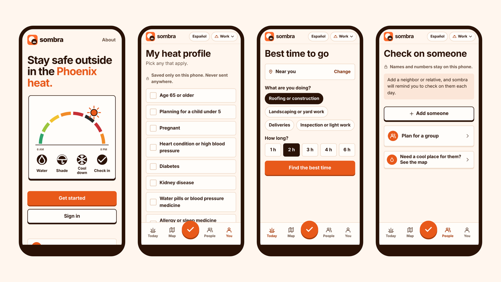

# sombra

**Stay safe outside in the Phoenix heat.**

Try it at **[sombraheat.com](https://sombraheat.com)**. It's free, works on any phone, and is fully bilingual in English and Spanish.



Built by Chase Phua for the 2026 Congressional App Challenge (AZ-03).

Every summer, people in Phoenix get sick or die from heat because nobody knew how dangerous a specific place was at a specific hour. A weather app says "108°F." It doesn't tell a roofer on a black roof to rest 40 minutes of every hour by 2 PM.

sombra turns the forecast for your exact spot into an hour-by-hour plan that says how long to rest in the shade and how much water to drink. Through the day it checks in on you and the people you look after.

## What it does

- **Heat stress from sun, humidity and wind.** Calculates outdoor wet-bulb globe temperature (WBGT) hour by hour with the Liljegren model, the method behind OSHA's outdoor WBGT calculator.
- **Hour-by-hour work and rest plan** from the U.S. Army TB MED 507 work/rest and water table, color-coded from Low to Extreme.
- **Site check.** Take a photo and an on-device model recognizes the surface (dark roof, asphalt, grass…) and shade, then adjusts the plan. Photos never leave the phone. You can also pick the surface yourself.
- **Check-ins.** Quick symptom check-ins with fixed safety rules: signs of heat stroke always open first-aid steps and a Call 911 button. Non-emergency messages are personalized with the worker's real numbers.
- **Official alerts and air quality.** National Weather Service heat and dust alerts, plus today's UV and air-quality peak for your spot.
- **What to bring.** A packing checklist built from your plan: how much water, sun protection, gloves for hot roofs, a mask on dusty days.
- **Best time to go.** Pick an activity and how long it takes; sombra finds the safest window in the next two days and the hours to avoid.
- **My heat profile.** Optional health factors (age, pregnancy, heart conditions, certain medicines) add extra caution. Saved only on the phone.
- **Cool spots nearby, and Cool down now.** A live map of places to refill water or get out of the sun (OpenStreetMap), plus the official Heat Relief Network cooling centers and hydration stations, with today's hours. One tap on *Cool down now* picks the nearest open place with AC (else water or shade) and opens walking directions.
- **Check on someone.** Daily reminders to check on an older relative or neighbor, with a call button and a stronger nudge during heat warnings.
- **Reminders when the app is closed.** Web Push notifications for check-on reminders, Best time windows and official heat warnings. The server never receives names; the phone fills them in.
- **Solo or group.** Works for one person by default; turn on a group when you need one (it's called a crew or a team in those modes).
- **Three modes:** Work crew, School & sports, and Everyday outdoors, with wording, activity examples and rules for each.
- **English and Spanish.** Works without an account; sign in to sync your plans and group across devices.

## Project layout

| Path | What's there |
| --- | --- |
| `artifacts/sombra` | The web app (React shell + planner page, configs for modes, schedule and site factors) |
| `artifacts/api-server` | Express API: weather + WBGT, check-ins, account data |
| `lib/heat-safety` | Shared safety rules, check-in templates and first-aid content |
| `lib/db` | PostgreSQL schema (Drizzle) |
| `lib/api-spec`, `lib/api-zod`, `lib/api-client-react` | OpenAPI contract and generated types |
| `tools` | Work toward version 2.0 (below) |

## How it works

1. The phone sends a location rounded to about half a mile. The server asks Open-Meteo for the hourly forecast there.
2. For each hour, the server calculates WBGT with the Liljegren model, using the sun's angle and how much sunlight the surface reflects.
3. Each hour's WBGT is matched to the Army work/rest table, then made stricter for anyone new to the heat, anyone with a heat profile factor, or School mode.
4. Check-ins are judged on the phone by fixed safety rules first. AI only words the friendly reply for non-emergencies, and the server can make a warning stricter but never weaker.

The front end is React and TypeScript (built with Vite), the server is Node and Express, and saved plans live in PostgreSQL through Drizzle.

## Run it locally

You need **Node.js 22 or newer**, **pnpm** and **PostgreSQL**.

```bash
git clone https://github.com/ChasePenn/sombra.git
cd sombra
pnpm install

# 1. Point the app at an empty Postgres database and create the tables
export DATABASE_URL=postgres://localhost:5432/sombra
pnpm --filter @workspace/db run push

# 2. Start the API (terminal 1)
PORT=8080 pnpm --filter @workspace/api-server run dev

# 3. Start the web app (terminal 2), sending /api requests to the API
API_URL=http://localhost:8080 PORT=5173 BASE_PATH=/ pnpm --filter @workspace/sombra run dev
```

Open <http://localhost:5173>. Everything works as a guest with just `DATABASE_URL`. These are optional:

| Variable | What it adds |
| --- | --- |
| `GEMINI_API_KEY`, `GEMINI_MODEL` | AI-worded check-in replies. Without them, sombra uses its written templates. |
| `CLERK_SECRET_KEY`, `CLERK_PUBLISHABLE_KEY`, `VITE_CLERK_PUBLISHABLE_KEY` | Accounts that sync plans across devices. Without them, sombra runs in guest mode. |
| `VAPID_PUBLIC_KEY`, `VAPID_PRIVATE_KEY`, `VAPID_SUBJECT`, `PUSH_CRON_SECRET` | Fixed push keys. Without them, the server creates its own on first run. |

Secrets stay on the server and are never sent to the browser. Push reminders go out every minute while the server is running, and the `Send due reminders` GitHub workflow wakes the deployed server every 5 minutes.

### Tests

```bash
pnpm run release-check
```

This runs the type checks, more than 200 automated tests and a production build. Add `DATABASE_URL` for the database tests, `CHROME_BIN` for the browser tests, and `-- --live` to call the real weather services.

## Tools for version 2.0

These run on their own and don't touch the live app.

| Tool | Language | What it does | Run it |
| --- | --- | --- | --- |
| `tools/python/check_data.py` | Python | Checks the saved cooling center and cool spot data and the work/rest table for mistakes | `python3 tools/python/check_data.py` |
| `tools/java/HeatPlan.java` | Java | The heat plan and safety rules, ready for a native Android app | `java tools/java/HeatPlan.java` |
| `tools/cpp/cool_now.cpp` | C++ | The Cool down now ranking, ready for offline and native use | `g++ -std=c++17 tools/cpp/cool_now.cpp -o cool_now && ./cool_now` |

## Sources

- Weather and air quality: [Open-Meteo](https://open-meteo.com/)
- Alerts: [National Weather Service API](https://www.weather.gov/documentation/services-web-api)
- Cool spots: [OpenStreetMap](https://www.openstreetmap.org/) via the Overpass API (a saved copy for metro Phoenix and Tucson, refreshed weekly)
- Official cooling centers: [Heat Relief Network](https://azmag.gov/Programs/Heat-Relief-Network), Maricopa Association of Governments (live public feed, with a weekly saved copy as backup)
- WBGT: Liljegren et al. (2008), as used by the [OSHA outdoor WBGT calculator](https://osha.prod.pace.dol.gov/heat-exposure/wbgt-calculator)
- Work/rest and water: U.S. Army TB MED 507
- Heat illness first aid: OSHA and CDC heat illness guidance
- On-device image model: Transformers.js with CLIP
- Fonts: Rubik; Atkinson Hyperlegible (Braille Institute, designed for legibility)

sombra supports, but does not replace, an employer's heat safety plan or medical care. In an emergency, call 911.

## License

MIT
